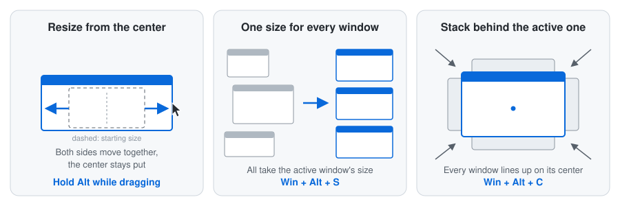
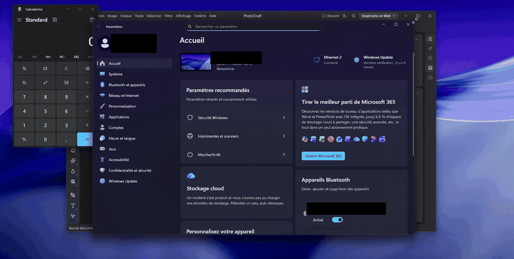
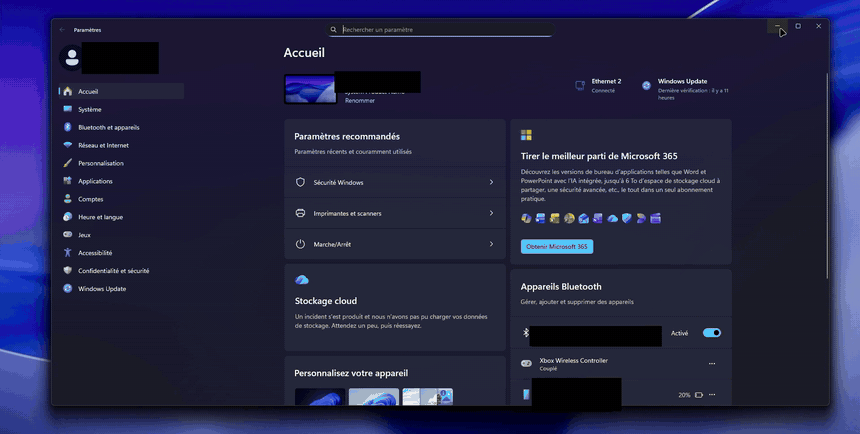
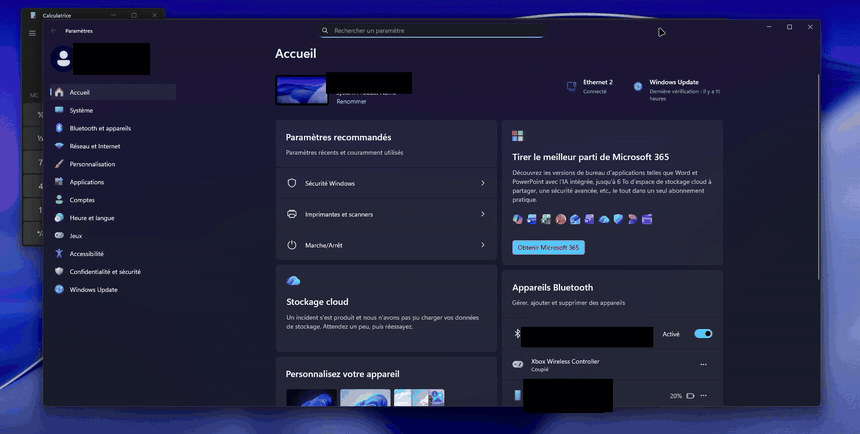

# Resize From Center & Window Sync

**A [Windhawk](https://windhawk.net/) mod for Windows that makes window layouts clean, symmetrical and consistent, with one key or one shortcut.**

| | What it does | How |
|---|---|---|
| ↔️ | **Resize from the center**: the window grows on both sides at once, its center doesn't move | Hold **Alt** while dragging an edge or a corner |
| 📐 | **One size for every window**: all open windows take the size of the active one | **Win + Alt + S** |
| 🎯 | **Stack behind the active one**: all other windows line up behind it, on its center | **Win + Alt + T** |

---

## Why you might want this

### If a window that's *almost* centered bothers you

Windows only resizes from one edge. Make a centered window wider and it isn't centered anymore, so you nudge it, resize again, nudge again… With this mod, hold **Alt** and drag: both sides move by the same amount, and the center stays exactly where it was. Drag a corner and it grows on all four sides. If you've used a Mac, this is the **Option-resize** your hands already know.

### If you like things to match

Five apps open, five slightly different sizes. **Win + Alt + S** gives every window the size of the one you're using, to the pixel. It measures the *visible* frame of each window, not the invisible resize borders Windows adds around most apps, so a Chrome window and a File Explorer window really do end up the same size. On a multi-monitor setup with different scaling (100 %, 150 %…), the size is adapted to each screen, so windows *look* the same size everywhere.

### If your desktop turns into a mess during the day

Place one window where you want to work, press **Win + Alt + T**, and every other window comes and lines up right behind it, centered on it. Maximized windows come back to their normal size and line up too. One shortcut, and the scattered desktop is a tidy pile you can flip through with Alt+Tab.

### Good for

- **Perfectionists** who want centered, symmetrical, identical windows without pixel-hunting.
- **Screen recording, streaming and tutorials**: consistent window sizes from one clip to the next, and windows centered in frame.
- **Screenshots and design reviews**: compare two apps or two versions at exactly the same size.
- **Ultrawide and large monitors**: keep your work in the middle of the screen, grow it evenly toward both sides.
- **Former Mac users** who miss Option-resize.

---

## Install

### From Windhawk (once the mod is approved)

The mod has been [submitted to the official Windhawk catalog](https://github.com/ramensoftware/windhawk-mods/pull/6153). Once it's accepted, search for **Resize From Center & Window Sync** in Windhawk's *Explore* tab and click **Install**.

### Manually, right now

1. Install [Windhawk](https://windhawk.net/).
2. In Windhawk, click **Create a New Mod**.
3. Replace all the code with the content of [`window-sync-center.wh.cpp`](window-sync-center.wh.cpp).
4. Click **Compile Mod** (Ctrl+B), then **Exit Editing Mode**.

## Settings

Everything is configured in the mod's **Settings** tab in Windhawk, and changes apply immediately.

| Setting | Default | Options |
|---|---|---|
| Key for resizing from the center | Alt | Alt, Ctrl, Shift, or disabled |
| Shortcut to give all windows the same size | Win + Alt + S | Any combination of Win / Ctrl / Alt / Shift + a key |
| Shortcut to stack all windows behind the active one | Win + Alt + T | Any combination of Win / Ctrl / Alt / Shift + a key |
| Common size | Size of the active window | Or a fixed size, in percent of the screen |
| Fixed width / height | 60 % / 70 % | 10 to 100 % |
| Title bar menu | On | Adds both commands to every window's title bar menu (right-click the title bar, or Alt + Space) |

## Details

- **Windows that are never moved**: fullscreen windows (games, videos), minimized windows, windows on other virtual desktops, dialogs, tool windows, the desktop and the taskbar. **Win + Alt + S** also leaves maximized windows alone.
- **Shortcuts that are already taken**: the shortcuts are read directly from the keyboard, so they work even when another app uses the same combination. For example, Win + Alt + T is also the Xbox Game Bar's recording timer shortcut; while the mod runs, the mod gets it. Pick another shortcut in the settings if you need the original one.
- **Apps running as administrator**: Windows doesn't let normal programs move their windows, so the shortcuts skip them.
- **Games with anti-cheat**: resizing from the center has to run inside each app, so the mod is loaded in every process. To exclude a program, add it to the custom process exclusion list in the mod's **Advanced** tab.
- **AltDrag**: the [AltDrag](https://windhawk.net/mods/alt-drag) mod also uses Alt. Holding Alt *before* clicking starts an AltDrag move; to resize from the center, start dragging the border first, then press Alt, or change the key of either mod.

## How it works

- **Resize from the center** handles `WM_SIZING` in a subclass of each top-level window. The edge you drag is mirrored on the opposite side, relative to where the window was when the drag started, and clamped to the window's own minimum and maximum size.
- **Win + Alt + S / Win + Alt + T** run in Explorer: they list the eligible windows, compute their visible frame with DWM, and move them with `SetWindowPos` (or `SetWindowPlacement` for maximized windows), without activating them or changing their stacking order.
- Disabling the mod removes everything it added: subclasses, title bar menu items, keyboard hook.

Tested on Windows 11 25H2 (build 26200) with Windhawk 1.7.3.

## License

[MIT](LICENSE). Made by [Jules](https://github.com/Topin5886), with the help of [Claude](https://claude.com/claude-code).
